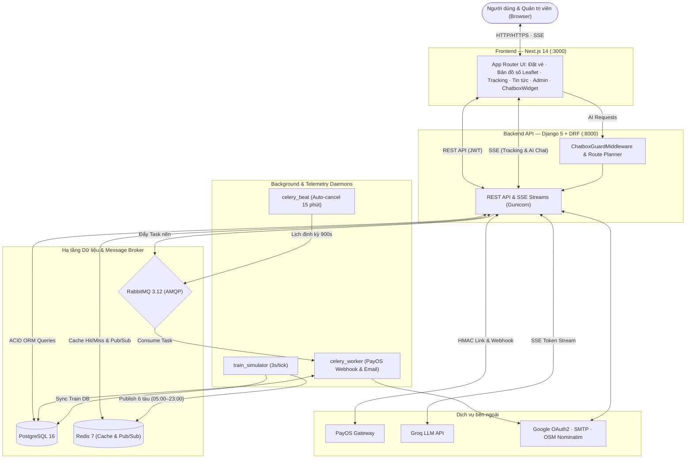

# HCMC Metro — Hệ thống Vé điện tử, Giám sát Tàu Real-time & Trợ lý AI

Nền tảng web toàn diện phục vụ hành khách và công tác vận hành cho tuyến **Metro số 1 TP.HCM (Bến Thành – Bến xe Suối Tiên)**, tích hợp theo dõi đoàn tàu thời gian thực, đặt vé điện tử 24/7 qua **PayOS**, bản đồ số **Leaflet**, hệ thống tin tức cập nhật tự động và trợ lý **AI** tìm đường đa phương thức.

---

## 1. Bối cảnh & Mục đích dự án

### Bối cảnh
Khi tuyến đường sắt đô thị đầu tiên của TP.HCM (Bến Thành – Suối Tiên, 14 nhà ga) đi vào vận hành thương mại cùng mạng lưới xe buýt điện gom khách và các tiện ích đô thị dọc Xa lộ Hà Nội – Võ Nguyên Giáp, nhu cầu chuyển đổi từ phương tiện cá nhân sang giao thông công cộng tăng nhanh. Tuy nhiên, hành khách (đặc biệt là sinh viên, người đi làm và khách vãng lai) thường gặp rào cản khi thông tin bị phân mảnh: khó ước lượng chính xác thời gian tàu cập ga, thiếu chỉ dẫn kết hợp từ điểm xuất phát → ga Metro → xe buýt/chặng cuối, và quy trình mua/nâng hạng vé trực tuyến chưa gắn kết đồng bộ với giờ vận hành.

### Mục đích
**HCMC Metro** được xây dựng nhằm hợp nhất toàn bộ hành trình trải nghiệm của hành khách và quy trình quản trị của đơn vị vận hành vào một nền tảng duy nhất:
- **Với hành khách:** Tra cứu vị trí tàu chạy trực tiếp theo từng giây, xem bản đồ số 14 ga kèm trạm xe buýt và tiện ích lân cận, đặt vé điện tử 24/7 với chính sách giá minh bạch (tự động giảm 30% cho học sinh – sinh viên), nhận mã QR qua email và hỏi đáp lộ trình đa phương thức với trợ lý AI.
- **Với quản trị viên:** Quản lý tập trung dữ liệu tuyến, ga, tàu, xe buýt, tiện ích, tin tức, tiếp nhận góp ý và soát vé QR trực tiếp tại cổng ga theo thời gian thực.

---

## 2. Công nghệ sử dụng — Lý do lựa chọn & Giá trị mang lại

| Thành phần | Công nghệ lựa chọn | Lý do lựa chọn (Why) | Giá trị cho dự án (Impact) |
|---|---|---|---|
| **Frontend** | **Next.js 14 (App Router), React 18, TypeScript, Tailwind CSS, Zustand** | Hỗ trợ SSR/App Router tối ưu SEO cho trang tin tức & tiện ích; TypeScript giảm lỗi runtime ở các luồng đặt vé/map phức tạp; Zustand quản lý state chọn ga/loại vé gọn nhẹ. | Trải nghiệm mượt mà, responsive đa thiết bị, duy trì giỏ đặt vé khi chuyển trang đăng nhập và tự động render bảng/thẻ lộ trình AI trực quan. |
| **Backend API** | **Django 5.0, Django REST Framework, SimpleJWT, Gunicorn** | Ecosystem chặt chẽ cho ORM, bảo mật xác thực JWT/Google OAuth, Validation rõ ràng và dễ tách Service Layer (`BookingService`, `TrackingService`). | Chuẩn hóa hơn 30+ endpoint REST & SSE, tích hợp sẵn OpenAPI/Swagger (`/api/schema/swagger-ui/`), dễ bảo trì và mở rộng. |
| **Database** | **PostgreSQL 16** | Đảm bảo tính toàn vẹn ACID cho giao dịch tài chính (`Ticket`, `Payment`), hỗ trợ `UUID`, `SELECT ... FOR UPDATE` chống race-condition khi xử lý webhook PayOS. | Không xảy ra trùng lặp kích hoạt vé hoặc sai lệch doanh thu khi PayOS gửi đồng thời webhook và return URL. |
| **Cache & Realtime Bus** | **Redis 7 (`django-redis`, Pub/Sub)** | Tốc độ đọc/ghi in-memory cực nhanh cho dữ liệu thay đổi liên tục và hỗ trợ sẵn mô hình Publisher/Subscriber. | Giảm ~90% độ trễ API đọc tin tức (từ ~49 ms xuống ~5 ms ở benchmark local), cache cự ly ga 24h và phát vị trí 6 đoàn tàu mỗi 3 giây tới mọi client SSE. |
| **Async & Scheduler** | **RabbitMQ 3.12, Celery Worker, Celery Beat** | Tách biệt các tác vụ chậm (gửi email QR, gọi verify PayOS) và tác vụ định kỳ (quét vé hết hạn) khỏi luồng HTTP request chính. | API thanh toán và đặt vé phản hồi ngay lập tức không bị nghẽn bởi SMTP; hệ thống tự động hủy vé lượt chưa sử dụng quá 2 ngày mỗi 15 phút. |
| **Thanh toán** | **PayOS SDK & HMAC-SHA256** | Hỗ trợ VietQR ngân hàng nội địa chuẩn xác, có API tạo link, verify return và webhook ký chữ ký điện tử. | Hành khách quét QR ngân hàng thanh toán tức thì, tự động kích hoạt vé và nhận email vé điện tử trong vài giây. |
| **Bản đồ số GIS** | **Leaflet (`react-leaflet`), OpenStreetMap** | Nhẹ, mã nguồn mở, tùy biến hoàn toàn marker icon, nhãn cố định trên bản đồ và đồng bộ nhiều lớp dữ liệu cùng lúc. | Hiển thị trực quan 14 ga (kèm nhãn tên cố định), 23 trạm bus, 36 tiện ích và chuyển động 6 đoàn tàu theo tọa độ thực. |
| **Trợ lý AI** | **Groq API (`llama-3.3-70b-versatile`), SSE, Nominatim OSM** | Groq cho tốc độ sinh token streaming rất nhanh; kết hợp tự điển `HCMC_LANDMARKS` nội bộ giúp định vị địa danh tức thì không phụ thuộc hoàn toàn API ngoài. | Trợ lý phản hồi streaming từng chữ mượt mà qua SSE, tự tính chi phí thực tế cho cả chặng Metro, xe buýt và xe ôm công nghệ. |
| **Hạ tầng** | **Docker & Docker Compose (9 services)** | Đóng gói đồng nhất 9 container (`frontend`, `backend`, `db`, `redis`, `rabbitmq`, `celery_worker`, `celery_beat`, `train_simulator`, `pgadmin`). | Dựng toàn bộ hệ thống ổn định chỉ bằng một câu lệnh, loại bỏ sai khác môi trường giữa máy phát triển và triển khai. |

---

## 3. Kiến trúc tổng thể hệ thống

Hệ thống được thiết kế theo kiến trúc phân tầng tách biệt rõ giữa **Presentation (Next.js)**, **API/Domain Services (Django DRF)**, **Background Daemons (Celery Worker, Celery Beat, Train Simulator)** và **Data/Broker Infrastructure (PostgreSQL, Redis, RabbitMQ)**:

### Sơ đồ kiến trúc tổng thể



### Các kênh giao tiếp chính
1. **HTTP/REST + JWT:** Xử lý nghiệp vụ người dùng, đặt vé, tính giá, quản trị, tin tức và bản đồ tĩnh.
2. **Server-Sent Events (SSE) + Redis Pub/Sub:** Stream hai luồng dữ liệu tức thời là vị trí đoàn tàu (`/api/metro/tracking/stream/`) và câu trả lời AI từng token (`/api/chatbox/message/`).
3. **AMQP Tasks (RabbitMQ → Celery):** Thực thi bất đồng bộ xử lý trạng thái thanh toán PayOS, gửi email QR/OTP/cảnh báo quét vé và chạy cronjob mỗi 15 phút để thu hồi vé lượt quá hạn 2 ngày.

---

## 4. Các chức năng chính của hệ thống

### Dành cho Người dùng cuối
- **Xác thực & Hồ sơ cá nhân:** Đăng ký qua email kèm OTP xác thực, đăng nhập JWT hoặc **Google OAuth2**, quên/đổi mật khẩu, quản lý thông tin cá nhân và ngày sinh phục vụ xét đối tượng học sinh – sinh viên.
- **Theo dõi tàu Real-time (`/lo-trinh`):** Sơ đồ vận hành trực quan 14 nhà ga, bảng trạng thái 6 đoàn tàu, tra cứu 3 tàu sắp cập ga (ETA) và tự động chuyển trạng thái ngừng vận hành đúng khung **23:00 – 05:00** giờ Việt Nam (`Asia/Ho_Chi_Minh`).
- **Bản đồ số tương tác (`/ban-do-so`):** Hiển thị 14 ga (nhãn tên ga cố định trên icon), vị trí tàu di chuyển trực tiếp, trạm xe buýt kết nối kèm lịch chạy và các tiện ích lân cận kèm panel chi tiết bên phải.
- **Đặt vé 24/7 & Thanh toán PayOS (`/dat-ve`):** Đặt vé lượt (1 chiều/khứ hồi), vé 1 ngày, vé 3 ngày, vé tháng; tự động tính giá theo khoảng cách ga và giảm **30%** cho hành khách `<= 22` tuổi; khóa hạ hạng vé nếu đang sở hữu vé hạng cao còn hạn; thanh toán PayOS và nhận vé QR qua email kèm ghi chú giờ chạy `05:00 – 23:00`.
- **Trợ lý AI tìm đường đa phương thức:** Widget chat hỗ trợ thu gọn hoặc phóng to nửa màn hình, tư vấn lộ trình 3 chặng (Điểm đi → Ga Metro → Đích đến bằng xe ôm công nghệ hoặc xe buýt thực tế trong DB).
- **Tiện ích quanh ga & Tin tức chính thống:** Tra cứu 36 điểm dịch vụ/ăn uống/mua sắm quanh ga (`/tien-ich`) và đọc tin tức cập nhật từ VnExpress, Tuổi Trẻ, Thanh Niên kèm liên kết tới bài gốc và cổng chính thức HURC1/MAUR (`/tin-tuc`).
- **Góp ý & Theo dõi xử lý:** Gửi phản hồi chất lượng dịch vụ kèm theo dõi trạng thái xử lý từ ban quản trị.

### Dành cho Quản trị viên (`/admin`)
- **Dashboard thống kê:** Theo dõi doanh thu, sản lượng vé và trạng thái hệ thống.
- **Soát vé QR tại cổng:** Quét mã QR từ camera/dữ liệu thô (`admin/bookings/scan/`), tự động kiểm tra hiệu lực, trừ `usage_remaining` và lưu `TicketScanHistory`.
- **Quản trị dữ liệu Metro:** CRUD tuyến, nhà ga, đoàn tàu, trạm xe buýt, tiện ích quanh ga, bài viết tin tức, tài khoản người dùng và xử lý góp ý.

---

## 5. Mô tả chi tiết các module trọng tâm

Tài liệu thiết kế chi tiết và sơ đồ kiến trúc riêng cho từng module được lưu tại thư mục `docs/`:

### 5.1. Module Metro Tracking Real-time ([Xem tài liệu chi tiết & sơ đồ kiến trúc](docs/metro-tracking-realtime.md))
- Container `train_simulator` chạy lệnh `manage.py run_train_simulator --interval 3` liên tục tính toán tọa độ 6 đoàn tàu theo tốc độ trung bình `45 km/h`, dừng ga `30s`, quay đầu `300s` bằng công thức **Haversine** và nội suy tuyến tính.
- Toàn bộ lịch chạy tuân thủ múi giờ `Asia/Ho_Chi_Minh`: đúng **23:00:00** chuyến tàu cuối kết thúc hành trình và toàn bộ hệ thống chuyển sang trạng thái `idle` cho tới **05:00:00** sáng hôm sau (không ghi log trạm giả vào PostgreSQL trong giờ nghỉ).
- Dữ liệu được cache vào Redis (`TTL 15s`) và broadcast qua Redis Pub/Sub tới `LiveTrainStreamView` (SSE + heartbeat 10s), giúp `/lo-trinh` và `/ban-do-so` cập nhật mượt mà theo thời gian thực.

### 5.2. Module Đặt vé & Thanh toán PayOS ([Xem tài liệu chi tiết & sơ đồ kiến trúc](docs/dat-ve.md))
- **Định giá & Nâng hạng thông minh:** `BookingService` tính cự ly giữa 2 ga bằng `geodesic` (cache Redis 24h), áp dụng công thức `7,000 + km × 1,000` (làm tròn 100 VNĐ), nhân đôi cho vé khứ hồi và giảm `30%` cho HSSV (`<= 22` tuổi). Hàm `validate_ticket_upgrade()` chặn mua vé hạng thấp hơn vé đang còn hiệu lực (`single < day < 3day/week < month`).
- **Thanh toán bất đồng bộ chống trùng lặp:** Khi PayOS trả webhook hoặc redirect return, `process_payment_status_update_task` khóa dòng `Payment` bằng `select_for_update()` trong `transaction.atomic()` để đảm bảo kích hoạt vé chính xác đúng 1 lần, sau đó đẩy `send_ticket_email_task` gửi mã QR + nhắc giờ hoạt động `05:00 – 23:00`.
- **Tự động hủy vé lượt sau 2 ngày:** Vé `single` có hạn 2 ngày; Celery Beat chạy `cancel_expired_single_tickets_task` mỗi 15 phút để tự động chuyển các vé lượt chưa từng quét (`TicketScanHistory`) quá 2 ngày sang trạng thái `cancelled`.

### 5.3. Module Trợ lý AI & Tìm đường Đa phương thức ([Xem tài liệu chi tiết & sơ đồ kiến trúc](docs/ai-assistant.md))
- **Bảo vệ nhiều lớp:** `ChatboxGuardMiddleware` kiểm tra độ dài tối đa 500 ký tự, sanitize HTML, chặn từ khóa `INPUT_BLOCKLIST` và giới hạn **20 tin nhắn/giờ** kết hợp view kiểm tra **100 tin nhắn/ngày** từ PostgreSQL.
- **Động cơ tìm đường 3 chặng (`route_planner.py`):** Kết hợp regex nhanh + Groq JSON để tách điểm đi/đến, định vị qua 4 tầng (`HCMC_LANDMARKS` 121 địa danh → `Station` DB → Redis cache → OSM Nominatim fallback), sau đó tính toán đồng thời phương án đi **xe ôm công nghệ** và phương án tiết kiệm kết hợp **xe buýt từ bảng `BusStop`** trước khi truyền số liệu thực vào prompt để Groq stream SSE câu trả lời.

---

## 6. Cấu trúc thư mục dự án

```text
HCMC-Metro/
├─ backend/                         # Django 5 + Django REST Framework
│  ├─ config/                       # Settings (base, dev, prod), Celery app & Root URLs
│  ├─ core/                         # Permissions, Pagination, Middleware & Exception handlers
│  ├─ infrastructure/               # Redis client & hạ tầng kết nối dùng chung
│  ├─ data/                         # Dữ liệu tọa độ tuyến Metro Line 1
│  └─ apps/
│     ├─ users/                     # Xác thực JWT, OTP, Google OAuth2, phân quyền & hồ sơ
│     ├─ metro/                     # Ga, tàu, bản đồ số, tiện ích, xe buýt & TrackingService
│     ├─ ticketing/                 # Loại vé, tính giá, nâng hạng, soát QR, email & Beat cleanup
│     ├─ payments/                  # Tích hợp PayOS, ký HMAC-SHA256 & xử lý webhook
│     ├─ news/                      # Tin tức Metro & crawler lấy tin từ báo chí uy tín
│     ├─ feedback/                  # Góp ý hành khách & quản trị phản hồi
│     └─ chatbox/                   # Guard middleware, rate limiter, route_planner & Groq SSE
├─ frontend/                        # Next.js 14 + React 18 + TypeScript + Tailwind CSS
│  ├─ public/images/                # Ảnh tĩnh đã kiểm duyệt cho tiện ích & bài viết tin tức
│  └─ src/
│     ├─ app/(routes)/              # Các route công khai ((main): dat-ve, lo-trinh, ban-do-so, tien-ich, tin-tuc) & admin
│     ├─ components/                # UI primitives (shadcn/ui), AppChrome, Navbar, Footer, ChatboxWidget
│     ├─ features/                  # Feature modules (auth, metro, news, feedback, admin)
│     ├─ store/                     # Zustand stores (useAuthStore, useBookingStore, useToastStore)
│     └─ lib/ & types/              # Axios client interceptors & TypeScript definitions
├─ database/
│  └─ schema.sql                    # Script khởi tạo schema & dữ liệu nền PostgreSQL
├─ docs/
│  ├─ metro-tracking-realtime.md    # Tài liệu kỹ thuật module Tracking Real-time
│  ├─ dat-ve.md                     # Tài liệu kỹ thuật module Đặt vé & Thanh toán PayOS
│  └─ ai-assistant.md               # Tài liệu kỹ thuật module Trợ lý AI
├─ references/                      # Domain reference notes cho dev
├─ .env.example                     # Mẫu biến môi trường cho Docker Compose
└─ docker-compose.yml               # Điều phối 9 container toàn hệ thống
```

---

## 7. Hướng dẫn chạy cục bộ (Local Setup)

### Yêu cầu môi trường
- **Docker** và **Docker Compose** (khuyến nghị RAM tối thiểu `8 GB`)
- **Git**

### Bước 1: Clone repository & tạo file `.env`
```bash
git clone <url-repository>
cd HCMC-Metro
cp .env.example .env
```

Cập nhật các nhóm biến môi trường quan trọng trong `.env`:
- **Database & Admin:** `DB_NAME`, `DB_USER`, `DB_PASSWORD`, `SECRET_KEY`, `PGADMIN_DEFAULT_EMAIL`, `PGADMIN_DEFAULT_PASSWORD`
- **Google OAuth2 (tùy chọn đăng nhập Google):** `GOOGLE_CLIENT_ID`, `GOOGLE_CLIENT_SECRET`, `NEXT_PUBLIC_GOOGLE_CLIENT_ID`
- **SMTP Email (gửi OTP & vé QR):** `EMAIL_HOST`, `EMAIL_PORT`, `EMAIL_HOST_USER`, `EMAIL_HOST_PASSWORD`, `DEFAULT_FROM_EMAIL`
- **PayOS Gateway:** `PAYOS_CLIENT_ID`, `PAYOS_API_KEY`, `PAYOS_CHECKSUM_KEY`
- **Groq AI Chatbox:** `GROQ_API_KEY`, `GROQ_MODEL`

### Bước 2: Khởi động toàn bộ 9 service bằng Docker Compose
```bash
docker compose up --build -d
```

Lệnh trên khởi động đồng thời:
`db` (PostgreSQL 16), `redis` (Redis 7), `rabbitmq` (RabbitMQ 3.12), `pgadmin`, `backend` (Django + Gunicorn), `frontend` (Next.js), `celery_worker`, `celery_beat` và `train_simulator`.

### Bước 3: Nạp dữ liệu mẫu thực tế (tùy chọn khi chạy lần đầu)
```bash
# Crawl tin tức Metro thật từ VnExpress, Tuổi Trẻ, Thanh Niên
docker compose exec backend python manage.py crawl_news

# Đồng bộ dữ liệu trạm xe buýt kết nối & thông tin tiện ích quanh 14 ga
docker compose exec backend python manage.py crawl_bus_stops
docker compose exec backend python manage.py update_amenities_data
```

### Bước 4: Truy cập các cổng dịch vụ
- **Ứng dụng Web (Next.js):** http://localhost:3000
- **Backend API (Django DRF):** http://localhost:8000
- **API Docs (Swagger UI):** http://localhost:8000/api/schema/swagger-ui/
- **RabbitMQ Management:** http://localhost:15672 (`guest` / `guest`)
- **pgAdmin:** http://localhost:5050

### Một số lệnh vận hành thường dùng
```bash
# Xem log các service
docker compose logs -f backend celery_worker train_simulator

# Chạy tác vụ dọn vé lượt quá hạn 2 ngày thủ công
docker compose exec backend python manage.py cancel_expired_single_tickets

# Dừng toàn bộ hệ thống
docker compose down
```
