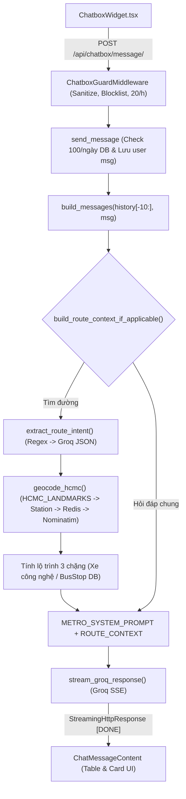

# Module Trợ lý AI (Chatbox & Tìm đường đa phương thức)

Tài liệu mô tả kiến trúc bảo mật đầu vào, cơ chế giới hạn tốc độ, bộ máy tìm đường đa phương thức 3 chặng (`route_planner`), luồng sinh câu trả lời streaming qua Groq LLM + SSE và giao diện hiển thị phản hồi trên widget Chatbox.

---

## 1. Tổng quan kiến trúc & Luồng xử lý

Mỗi tin nhắn từ người dùng đi qua lớp kiểm duyệt bảo mật **Middleware**, lưu phiên hội thoại vào PostgreSQL, tự động phân tích xem người dùng có đang hỏi tìm đường tại TP.HCM hay không để tính lộ trình thực tế bằng tọa độ + CSDL `BusStop`/`Station` rồi mới đưa vào prompt gửi **Groq API** stream về giao diện theo chuẩn **SSE**.

---

## 2. Cấu trúc file & Thành phần sở hữu

### Backend
- **Guard Middleware:** `backend/apps/chatbox/middleware.py` (`ChatboxGuardMiddleware`)
- **Rate Limiter:** `backend/apps/chatbox/services/rate_limiter.py`
- **Route Recommendation Engine:** `backend/apps/chatbox/services/route_planner.py`
- **AI Prompt & Streaming Service:** `backend/apps/chatbox/services/chatbox_ai.py`, `backend/apps/chatbox/config/system_prompt.py`, `backend/apps/chatbox/config/blocklist.py`
- **Controllers & Models:** `backend/apps/chatbox/views/chatbox.py`, `backend/apps/chatbox/models.py` (`ChatSession`, `ChatMessage`), `backend/apps/chatbox/urls.py`

### Frontend
- **Chat Widget & Markdown/Table Renderer:** `frontend/src/components/chatbox/ChatboxWidget.tsx`

---

## 3. Các tầng xử lý chi tiết

### A. Bảo vệ & Kiểm soát lưu lượng (`ChatboxGuardMiddleware` & `rate_limiter.py`)
Trước khi chạm tới View/LLM, `POST /api/chatbox/message/` phải qua các kiểm tra sau:
- **Session token hợp lệ:** Bắt buộc `session_token` độ dài tối thiểu 10 ký tự.
- **Rate limit theo giờ (`is_rate_limited`):** Tối đa **20 tin nhắn / giờ / `session_token`** lưu in-memory có khóa `threading.Lock()`.
- **Rate limit theo ngày (`check_daily_limit_from_db`):** Kiểm tra trong bảng `ChatMessage`, giới hạn **100 tin nhắn / ngày / session** (ghi cảnh báo log ở ngưỡng 50).
- **Sanitize & Chặn từ khóa:** Escape HTML (`html.escape`), loại thẻ `<...>` và ký tự điều khiển, giới hạn tối đa **500 ký tự** (`MAX_MESSAGE_LENGTH = 500`), chặn tin nhắn vô nghĩa dưới 4 ký tự hoặc chứa từ khóa trong `INPUT_BLOCKLIST`.

### B. Bộ máy tìm đường đa phương thức (`route_planner.py`)
Khi phát hiện câu hỏi tìm đường (`looks_like_route_query()`):
1. **Trích xuất điểm đi / điểm đến (`extract_route_intent`):**
   - Ưu tiên `_regex_extract_route()` để tách trực tiếp cặp `<origin> -> <destination>` từ câu tiếng Việt tự nhiên (có kiểm tra từ khóa mơ hồ như `"nhà mình"`, `"chỗ làm"`, `"đây"` và từ khóa `"sinh viên"`/`"hssv"`).
   - Nếu regex không bắt được mẫu câu phức tạp, gọi **Groq API** (`temperature=0.1`) trả JSON có cấu trúc; nếu điểm đi/đến còn mơ hồ, hướng dẫn AI hỏi lại lịch sự.
2. **Định vị tọa độ TP.HCM (`geocode_hcmc`):**
   - Tầng 1: Tra cứu trực tiếp không độ trễ trong từ điển `HCMC_LANDMARKS` (chuẩn hóa bỏ dấu tiếng Việt, khớp chính xác, khớp ranh giới từ và khớp theo token chồng lấp để nhận diện tên viết tắt phổ biến như `KCNC`, `UTC2`, `HCMUTE`, `UTH`, `ĐHQG` mà không cần gọi API ngoài).
   - Tầng 2 (Fallback): Gọi OpenStreetMap Nominatim giới hạn trong bounding box TP.HCM và cache kết quả nếu địa điểm chưa có trong từ điển.
3. **Tính toán lộ trình 3 chặng có số liệu thực tế (`ROAD_FACTOR = 1.25`):**
   - **Chặng 1 (Điểm đi → Ga Metro gần nhất):** Gợi ý đi bộ nếu `<= 0.4 km` hoặc ước tính cước xe ôm công nghệ.
   - **Chặng 2 (Tuyến Metro số 1):** Chọn ga đi (`dep_station`) và ga đến (`arr_station`) gần nhất, tính số trạm dừng (`station_hops`), thời gian di chuyển ước tính, và **tính đúng giá vé Metro** thông qua `BookingService.calculate_price()` (có áp dụng giảm 30% nếu phát hiện ngữ cảnh HSSV).
   - **Chặng 3 (Ga đến → Đích đến — 2 phương án ngân sách):**
     - *Option 1 (Nhanh nhất):* Đi xe ôm công nghệ thẳng từ ga đến.
     - *Option 2 (Tiết kiệm):* Truy vấn `BusStop` gần nhất trong PostgreSQL, tìm tuyến buýt kết nối phù hợp, tính tổng chi phí (vé buýt + đi bộ / xe công nghệ đoạn cuối) và số tiền tiết kiệm được so với Option 1.

### C. Ngữ cảnh hệ thống & Streaming Groq (`chatbox_ai.py`)
- `_build_system_context()` nạp dữ liệu động từ DB (`Station`, `MetroLine`), thông tin giá vé, các tuyến buýt trọng điểm và giờ hoạt động vào `METRO_SYSTEM_PROMPT`.
- Giữ cửa sổ ngữ cảnh **10 tin nhắn gần nhất** (`HISTORY_WINDOW = 10`).
- `stream_groq_response()` gọi `https://api.groq.com/openai/v1/chat/completions` (`stream=True`, `temperature=0.5`, `timeout=30`), phát từng chunk JSON `{"content": ...}` qua `StreamingHttpResponse` và kết thúc bằng `[DONE]`.
- Sau khi stream xong, tính `response_time_ms`, kiểm tra `OUTPUT_SENSITIVE_KEYWORDS` (`is_flagged`), và lưu `ChatMessage` cùng `tokens_used` vào DB.

---

## 4. API Endpoints

| Endpoint | Method | Quyền | Mô tả |
|---|---|---|---|
| `/api/chatbox/message/` | `POST` | `AllowAny` | Nhận `{ "message", "session_token" }`, trả `text/event-stream` SSE từng chunk và tự lưu lịch sử hội thoại. |
| `/api/chatbox/history/<str:session_token>/` | `GET` | `AllowAny` | Tải lịch sử tin nhắn của `ChatSession` đang active. |
| `/api/chatbox/history/<str:session_token>/delete/` | `DELETE` | `AllowAny` | Đóng phiên cũ (`is_active=False`) để bắt đầu cuộc trò chuyện mới. |

---

## 5. Giao diện Chatbox (`ChatboxWidget.tsx`)

- **Cửa sổ linh hoạt:** Nút `#chatbox-expand-btn` cho phép chuyển đổi giữa chế độ popup gọn (`360px × 520px`) và chế độ mở rộng nửa màn hình (`min(50vw, 720px) × 82vh`), lưu `session_token` trong `localStorage` (`chatbox_session_token`).
- **Bộ render `<ChatMessageContent />`:**
  - Chuyển đổi bảng Markdown (`| ... |`) thành bảng HTML bo góc có thanh cuộn ngang, header rõ ràng.
  - Chuyển gạch phân cách `---` thành đường line mảnh, gom tiêu đề lộ trình (`🚇`, `##`, `###`) và thẻ chặng (`1️⃣`, `Chặng 1/2/3`, `Option 1/2`) thành các khối card nổi bật.
  - Chuẩn hóa ký tự mũi tên `$\rightarrow$` → `→`, hỗ trợ `**bold**`, `` `code` ``, link `[text](url)`, danh sách đánh số và gạch đầu dòng không thừa khoảng trắng ` ` khi stream.
