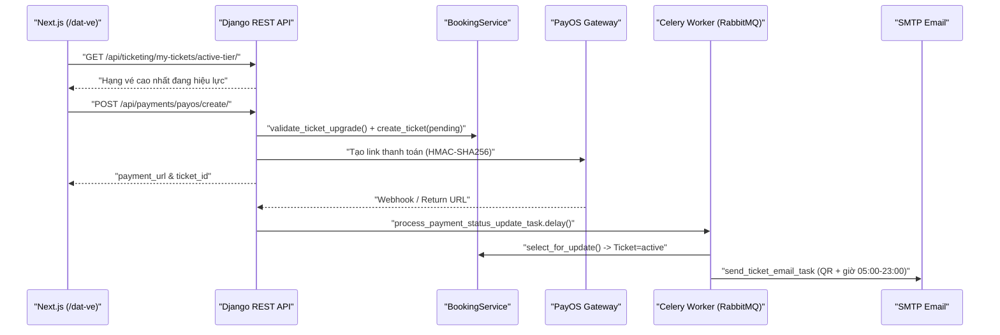

# Module Đặt vé & Thanh toán (Ticketing & PayOS)

Tài liệu mô tả quy trình nghiệp vụ đặt vé, tính giá tự động, quy tắc nâng hạng vé, tích hợp cổng thanh toán PayOS, xử lý webhook bất đồng bộ bằng Celery/RabbitMQ, soát vé QR và cơ chế tự động hủy vé lượt quá hạn.

---

## 1. Tổng quan luồng đặt vé & Thanh toán

Hệ thống cho phép hành khách đặt tất cả các hạng vé **24/7** (kể cả ngoài khung giờ tàu chạy 23:00–05:00), thanh toán qua **PayOS**, kích hoạt vé bất đồng bộ và gửi email kèm mã QR + thông báo giờ vận hành.

---

## 2. Cấu trúc file & Thành phần sở hữu

### Backend
- **Ticketing Models:** `backend/apps/ticketing/models.py` (`TicketType`, `Ticket`, `TicketScanHistory`)
- **Booking & Validation Service:** `backend/apps/ticketing/services/booking_service.py` (`BookingService`)
- **Ticketing Views & Serializers:** `backend/apps/ticketing/views.py`, `backend/apps/ticketing/serializers.py`, `backend/apps/ticketing/urls.py`
- **Email Service & Celery Tasks:** `backend/apps/ticketing/services/email_service.py` (`TicketEmailService`), `backend/apps/ticketing/tasks.py`
- **Cleanup Command:** `backend/apps/ticketing/management/commands/cancel_expired_single_tickets.py`
- **PayOS Integration:** `backend/apps/payments/views.py`, `backend/apps/payments/services/payos_service.py`, `backend/apps/payments/tasks.py`, `backend/apps/payments/models.py`, `backend/apps/payments/urls.py`
- **Celery Beat Schedule:** `backend/config/settings/base.py` (`CELERY_BEAT_SCHEDULE`)

### Frontend
- **Trang đặt vé:** `frontend/src/app/(routes)/(main)/dat-ve/page.tsx`
- **Store đặt vé:** `frontend/src/store/use-booking-store.ts`

---

## 3. Quy tắc nghiệp vụ cốt lõi

### A. Công thức tính giá & Cache cự ly (`BookingService.calculate_price`)
- **Vé lượt (`single`):**
  - Khoảng cách địa lý giữa 2 ga (`from_st`, `to_st`) được tính bằng `geopy.distance.geodesic` và cache vào Redis theo key `distance:<min_id>:<max_id>` trong `86400` giây (24 giờ).
  - Giá gốc = `7,000 + dist_km * 1,000` (VNĐ), làm tròn tới bội `100`.
  - Nếu `is_round_trip = True`: giá nhân đôi (`x2`) và cấp `usage_remaining = 2` lượt quét (thay vì `1`).
- **Vé thời hạn (`day`, `3day`, `month`):** Lấy trực tiếp giá niêm yết của `TicketType`, `usage_remaining = None` (không giới hạn lượt trong hạn dùng).
- **Ưu đãi Học sinh – Sinh viên (`hssv`):** Dựa vào `user.date_of_birth`, hành khách có tuổi `<= 22` (`STUDENT_MAX_AGE = 22`) được tự động giảm **30%** (`STUDENT_DISCOUNT_RATE = Decimal("0.30")`).

### B. Quy tắc chỉ nâng hạng vé (`BookingService.validate_ticket_upgrade`)
- Hệ thống xếp hạng thứ bậc các loại vé qua `TICKET_TIER_RANK`:
  - `single`: `1` < `day`: `2` < `3day` / `week`: `3` < `month`: `4` (loại khác: `10 + duration_days`).
- Trước khi tạo vé tại cả `BookingViewSet.book` lẫn `PayOSCreatePaymentAPIView.post`, hệ thống tìm vé có hạng cao nhất còn hiệu lực (`status in ["active", "used"]`, `valid_until >= today`, `usage_remaining != 0`).
- Nếu hạng vé mới định mua **nhỏ hơn** hạng vé đang có (`new_rank < current_rank`), backend từ chối với HTTP `400 Bad Request` và UI `/dat-ve` khóa các thẻ vé hạng thấp với nhãn *"Chỉ hỗ trợ nâng cấp"*.

### C. Hạn dùng vé lượt & Tự động hủy sau 2 ngày không sử dụng
- Khi tạo vé lượt (`type == "single"`), hệ thống cấp thời hạn **2 ngày** (`valid_until = valid_from + timedelta(days=2)`).
- Hàm `BookingService.expire_outdated_tickets()` thực hiện 2 bước:
  1. **Hủy vé lượt chưa dùng quá 2 ngày:** Tìm các vé `single` ở trạng thái `active` hoặc `pending` không có bản ghi quét nào trong `TicketScanHistory` và đã quá hạn (`created_at <= now - 2 days` hoặc `valid_until < today`) → cập nhật `status = "cancelled"`, đồng thời chuyển các bản ghi `Payment` đang `pending` liên quan sang `failed`.
  2. **Hết hạn vé còn lại:** Các vé đã quá `valid_until` hoặc có `usage_remaining == 0` chuyển sang `status = "expired"`.
- Được kích hoạt tự động qua 3 kênh:
  - **Celery Beat định kỳ mỗi 15 phút (900 giây):** Task `apps.ticketing.tasks.cancel_expired_single_tickets_task`.
  - **Lazy check khi truy vấn:** Trong `MyTicketViewSet.get_queryset`, `AdminTicketViewSet.get_queryset`, `get_highest_active_ticket` và trước khi `scan_ticket`.
  - **Lệnh thủ công:** `python manage.py cancel_expired_single_tickets`.

### D. Đặt vé 24/7 & Thông báo email giờ tàu chạy
- Frontend `/dat-ve` cho phép đặt tất cả hạng vé 24/7 và hiển thị khung thông tin giờ vận hành Metro (`05:00 – 23:00`).
- `TicketEmailService.send_ticket_email()` đính kèm ảnh QR (`PNG` inline/attachment) và khung cảnh báo rõ: Metro hoạt động hàng ngày từ **05:00 đến 23:00** (chuyến cuối kết thúc lúc 23:00) cùng hạn tự hủy 2 ngày đối với vé lượt chưa sử dụng.

---

## 4. API Endpoints chính

### Ticketing (`/api/ticketing/`)
| Endpoint | Method | Quyền | Mô tả |
|---|---|---|---|
| `/api/ticketing/types/` | `GET` | `AllowAny` | Danh sách loại vé đang mở bán (`single`, `day`, `3day`, `month`). |
| `/api/ticketing/types/stations/` | `GET` | `AllowAny` | Danh sách ga Metro chọn điểm đi/đến. |
| `/api/ticketing/booking/calculate/` | `POST` | `AllowAny` | Tính trước giá vé, áp dụng tự động giảm 30% HSSV nếu đã đăng nhập và đủ điều kiện tuổi. |
| `/api/ticketing/booking/book/` | `POST` | `IsAuthenticated` | Tạo vé trực tiếp (`active`) kèm validate nâng hạng & gửi email bất đồng bộ. |
| `/api/ticketing/my-tickets/` | `GET` | `IsAuthenticated` | Lịch sử vé của người dùng (tự chạy `expire_outdated_tickets()` trước khi trả). |
| `/api/ticketing/my-tickets/active-tier/` | `GET` | `IsAuthenticated` | Trả về hạng vé cao nhất đang hiệu lực để UI khóa hạ hạng vé. |
| `/api/ticketing/my-tickets/<uuid>/cancel/` | `POST` | `IsAuthenticated` | Hủy vé đang `pending`. |
| `/api/ticketing/admin/bookings/scan/` | `POST` | `IsAdminUser` | Soát vé qua QR (JSON / `QR-UUID` / `uuid`), trừ lượt `usage_remaining`, lưu `TicketScanHistory` và gửi email thông báo. |

### Payments (`/api/payments/`)
| Endpoint | Method | Mô tả |
|---|---|---|
| `/api/payments/payos/create/` | `POST` | Validate nâng hạng, tạo `Ticket(status="pending")` + `Payment(status="pending")` trong `transaction.atomic()` và gọi PayOS tạo link thanh toán ký HMAC-SHA256. |
| `/api/payments/payos/continue/` | `POST` | Tạo lại link thanh toán cho vé đang `pending`. |
| `/api/payments/payos/return/` & `cancel/` | `GET` | Redirect về frontend kèm query kết quả. |
| `/api/payments/payos/verify-return/` | `POST` | Kích hoạt task `process_payment_status_update_task.delay(...)` khi user quay lại từ PayOS. |
| `/api/payments/payos/webhook/` | `POST` | Xác thực chữ ký PayOS bằng `verifyPaymentWebhookData()` và đẩy xử lý idempotent vào Celery (`select_for_update()` khóa dòng chống trùng giữa webhook và redirect). |
