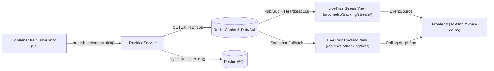

# Module Metro Tracking Real-time

Tài liệu mô tả kiến trúc, thuật toán định vị, luồng phát dữ liệu thời gian thực và giao diện hiển thị cho module **Metro Tracking Real-time** trên tuyến Metro số 1 (Bến Thành – Bến xe Suối Tiên).

---

## 1. Tổng quan kiến trúc & Luồng dữ liệu

Hệ thống mô phỏng 6 đoàn tàu chạy khép kín hai chiều (`MT-L1-OU-1..3` lượt đi và `MT-L1-IN-1..3` lượt về) theo múi giờ chuẩn Việt Nam (`Asia/Ho_Chi_Minh`), phát telemetry mỗi **3 giây** qua **Redis Pub/Sub** và đẩy tới trình duyệt thông qua **Server-Sent Events (SSE)**.

---

## 2. Cấu trúc file & Thành phần sở hữu

### Backend
- **Telemetry Simulator Command:** `backend/apps/metro/management/commands/run_train_simulator.py`
- **Core Service:** `backend/apps/metro/services/tracking_service.py` (`TrackingService`)
- **API Views:** `backend/apps/metro/views/tracking_views.py` (`LiveTrainTrackingView`, `StationArrivalETAView`, `StationListView`, `LiveTrainStreamView`)
- **URL Routing:** `backend/apps/metro/urls.py`
- **Models:** `backend/apps/metro/models.py` (`Station`, `Train`, `TrainStationLog`)

### Frontend
- **Service Client:** `frontend/src/features/metro/services/TrackingService.ts`
- **Dashboard `/lo-trinh`:**
  - `frontend/src/features/metro/components/RouteLookup.tsx`
  - `frontend/src/features/metro/components/LiveMetroTracker.tsx`
  - `frontend/src/features/metro/components/LiveTrainTable.tsx`
- **Bản đồ số `/ban-do-so`:** `frontend/src/features/metro/components/DigitalMap/DigitalMapClient.tsx`

---

## 3. Thuật toán tính toán vị trí & Thời gian vận hành

Các tham số cấu hình mặc định trong `TrackingService`:
- **Múi giờ chuẩn:** `HCMC_TZ = ZoneInfo("Asia/Ho_Chi_Minh")` (đồng bộ với `TIME_ZONE = "Asia/Ho_Chi_Minh"` trong `settings/base.py`).
- **Khung giờ hoạt động:** `05:00:00` (`START_TIME_DAILY`) đến `23:00:00` (`END_TIME_DAILY`).
- **Tốc độ trung bình:** `AVERAGE_SPEED_KPH = 45.0` km/h (có jitter ±2.5 km/h khi simulator phát sóng).
- **Thời gian dừng ga (Dwell):** `DWELL_TIME_SECONDS = 30` giây mỗi trạm.
- **Thời gian quay đầu (Turnaround):** `TURNAROUND_TIME_SECONDS = 300` giây tại 2 ga đầu cuối.
- **Giãn cách xuất bến:** `TRAIN_INTERVAL_MINUTES = 5` phút giữa 3 tàu cùng chiều.

### Cơ chế giờ nghỉ (23:00 – 05:00) & Kết thúc chuyến cuối đúng 23:00
1. Khi `now < 05:00:00` hoặc `now >= 23:00:00`:
   - Toàn bộ 6 tàu chuyển sang `status = "idle"`, `speed_kph = 0.0`, `is_operating = False`, `operating_hours = "05:00 - 23:00"`, nằm tại ga đầu/cuối.
   - `sync_trains_to_db()` cập nhật bảng `Train` về `status = "stopped"` và **bỏ qua ghi `TrainStationLog`** trong khung giờ nghỉ để tránh spam DB.
   - `get_station_arrivals()` trả về danh sách rỗng `[]`.
2. Đảm bảo kết thúc đúng mốc **23:00:00**:
   - Trong giờ chạy, `_calculate_train_position()` dùng ngưỡng `cutoff` để không cho phép khởi hành các lượt đi/về có `trip_end_time > cutoff`.
   - Đối với slot tàu cuối (`is_final_slot=True`, tức tàu số 3 mỗi chiều), lượt cuối bắt đầu tại `final_trip_start = 23:00:00 - one_way_duration` và hoàn tất cập bến ga cuối ngay trước `23:00:00`, chuyển sang `idle` đúng tại mốc `23:00:00`.

### Nội suy vị trí & Dự báo ETA
- Khoảng cách từng đoạn giữa 2 ga liền kề được tính theo công thức **Haversine** (`_calculate_haversine`), suy ra thời gian di chuyển phân đoạn `seg_travel_time = (dist / 45.0) * 3600`.
- Nội suy tuyến tính tọa độ `(latitude, longitude)` theo `seg_progress = (progress - accumulated_time) / seg_travel_time` để biểu diễn mượt chuyển động trên tuyến.
- `_calculate_eta_to_station()` cộng dồn thời gian còn lại ở đoạn đang chạy cộng với tổng thời gian di chuyển + dừng 30s của các ga kế tiếp cho tới ga mục tiêu.

---

## 4. API Endpoints

Tất cả endpoint tracking có prefix `/api/metro/` và cho phép truy cập công khai (`AllowAny`):

| Endpoint | Method | Mô tả |
|---|---|---|
| `/api/metro/tracking/live/` | `GET` | Đọc snapshot telemetry từ Redis (`hcmc_metro:tracking:live_trains`), fallback sang `_compute_train_states()` nếu Redis trống/mất kết nối. |
| `/api/metro/tracking/stream/` | `GET` | Mở kết nối `text/event-stream` (SSE) lắng nghe Redis Pub/Sub `hcmc_metro:tracking:updates`; gửi heartbeat mỗi 10s; tự động fallback vòng lặp 3s nếu không có Redis. |
| `/api/metro/tracking/eta/<int:station_id>/` | `GET` | Trả về danh sách tàu sắp cập ga mục tiêu kèm `eta_seconds` và `eta_minutes` (sắp xếp tăng dần). Trả `[]` ngoài giờ hoạt động. |
| `/api/metro/tracking/stations/` | `GET` | Danh sách các ga đang hoạt động sắp theo `sequence_order` phục vụ bộ lọc và sơ đồ tuyến. |

---

## 5. Hành vi giao diện (Frontend)

- **`TrackingService.subscribeToLiveTrains()`** kết nối trực tiếp tới `/api/metro/tracking/stream/` bằng `EventSource`.
- **`LiveMetroTracker.tsx`**:
  - Vẽ sơ đồ vòng tuyến Metro, cập nhật vị trí icon tàu realtime; tự động ẩn hiệu ứng pulse và hiện banner cảnh báo *"Hệ thống Metro tạm ngừng vận hành (23:00 – 05:00)"* khi tất cả tàu ở trạng thái `idle`.
- **`LiveTrainTable.tsx`**:
  - Hiển thị mã tàu, lượt đi/về, ga hiện tại, ga tiếp theo, đếm ngược `MM:SS` và badge trạng thái (`Đang di chuyển` / `Đang dừng ga` / `Ngừng vận hành (23:00–05:00)`).
- **`DigitalMapClient.tsx`**:
  - Gắn `outboundTrainIcon` (xanh dương) và `inboundTrainIcon` (xanh ngọc) di chuyển trực tiếp trên bản đồ Leaflet cùng nhãn tên cố định **`Ga <Tên ga>`** luôn hiển thị trên từng icon nhà ga.
